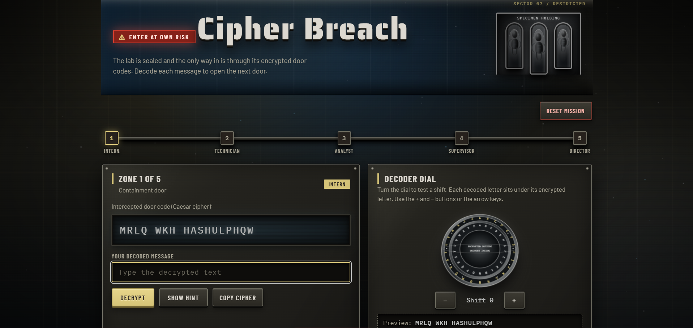
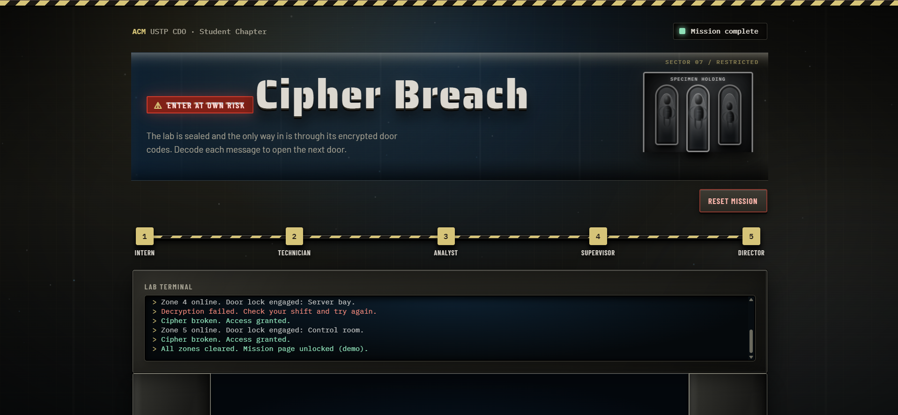

# 🔐 Cipher Breach

**An Interactive Caesar Cipher Puzzle Game**

Cipher Breach is a browser-based puzzle game developed for **ACM USTP CDO – Student Chapter**. Players must decode encrypted messages using the Caesar Cipher to unlock restricted laboratory zones and complete a series of challenges.

Enter the laboratory, solve the encrypted codes, and breach the containment system!





## 🚀 Features

- **Five Progressive Levels** – Complete five challenges with increasing difficulty, from Intern to Director.
- **Caesar Cipher Encryption** – Decode messages using different letter-shifting techniques.
- **Interactive Decoder Wheel** – Rotate the cipher dial to experiment with different shift values.
- **Hints System** – Receive clues to help solve difficult puzzles.
- **Progress Tracking** – Monitor completed levels through the mission progress indicator.
- **Automatic Progress Saving** – Your progress is saved locally using browser Local Storage.
- **Interactive Terminal** – Displays system messages and gameplay feedback.
- **Sci-Fi Visual Effects** – Features animated backgrounds, glitch effects, and a laboratory-inspired interface.
- **Responsive Design** – Designed to work across desktop and mobile screen sizes.

## 🎮 How to Play

1. Open the game in your browser.
2. Read the encrypted message displayed in the current zone.
3. Use the decoder wheel to experiment with different Caesar Cipher shifts.
4. Enter your decoded message in the answer field.
5. Click **Decrypt** to check your answer.
6. If correct, the next door will unlock.
7. Complete all five zones to finish the mission.

**Controls:**
- `+` / `−` – Increase or decrease the decoder shift.
- `←` / `→` – Adjust the decoder wheel using your keyboard.
- `Show Hint` – Display a clue for the current puzzle.
- `Copy Cipher` – Copy the encrypted message.
- `Reset Mission` – Restart the game and clear saved progress.

## 🛠️ Technologies Used

| Technology | Purpose |
|---|---|
| HTML5 | Structures the game interface and content. |
| CSS3 | Handles styling, animations, transitions, and responsive layouts. |
| JavaScript | Implements cipher encryption, puzzle logic, game controls, and progress saving. |
| SVG | Creates the interactive Caesar Cipher decoder wheel. |
| Canvas API | Generates animated background particles. |
| Local Storage | Saves the player's completed mission progress. |

## 📂 Project Structure

```text
Cipher-Breach/
│
├── index.html      # Main game interface
├── style.css       # Design, layout, and animations
├── script.js       # Game mechanics and cipher logic
└── README.md       # Project documentation
```

## 💻 Installation and Setup

No additional software or dependencies are required.

**1. Clone the repository**

```bash
git clone https://github.com/USERNAME/REPOSITORY-NAME.git
```

**2. Navigate to the project folder**

```bash
cd REPOSITORY-NAME
```

**3. Launch the game**

Open `index.html` in your preferred web browser.

Alternatively, use the **Live Server** extension in Visual Studio Code for a local development server.

## 🔒 About the Caesar Cipher

The Caesar Cipher is a substitution encryption technique that shifts each letter of the alphabet by a fixed number of positions.

For example, with a shift of 3:

| Original | Encrypted |
|---|---|
| A | D |
| B | E |
| C | F |
| HELLO | KHOOR |

To decrypt a message, shift each encrypted letter backward by the same number of positions.

## 💾 Progress Saving

Cipher Breach uses the browser's Local Storage to remember completed levels.

- Progress is saved automatically after successfully completing a puzzle.
- Saved progress remains available when reopening the game in the same browser.
- Use **Reset Mission** to clear your saved progress.

## 👥 Credits

**Developed for:**

ACM USTP CDO – Student Chapter

**Project:** Cipher Breach

---

*Decode the message. Unlock the doors. Complete the breach.*
